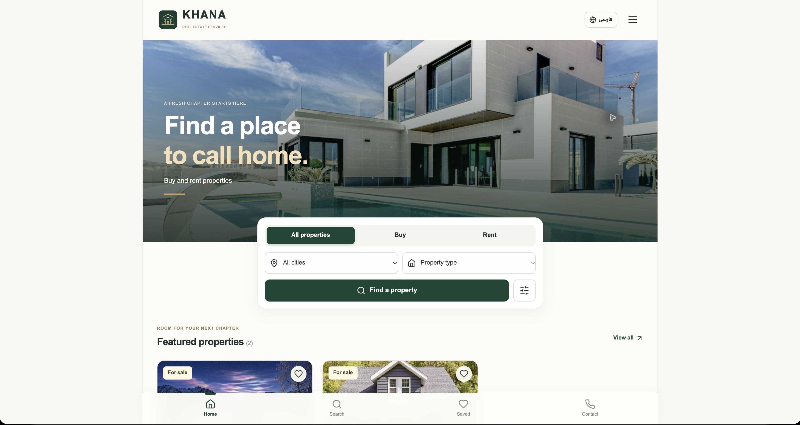

# Khana Website

**Mobile-first real estate listing and administration platform**

Khana Website is designed to help real estate offices present properties online and manage their listings through a dedicated administration interface.

## Interface preview

## Project highlights

- Responsive property browsing and photo galleries
- Search and filters for property features and amenities
- Property publishing, editing, archiving and restoration
- Role-based staff management and activity history
- Device access management for a companion macOS application
- English and Persian/Dari interface support

## Technology

React · JavaScript · Vite · Firebase Hosting · Cloud Firestore · Cloud Functions · Firebase Storage

## Architecture overview

The platform separates public property browsing from administrative operations. A companion desktop application supports controlled publishing and synchronization. Production infrastructure and implementation details are intentionally excluded from this portfolio.

## Project status

Portfolio showcase of a developed platform. This repository contains documentation only and is not connected to a live database or production deployment.

## Source availability

The original source code, production configuration, credentials and customer data are not distributed through this repository. No permission to use or redistribute the proprietary implementation is granted.
